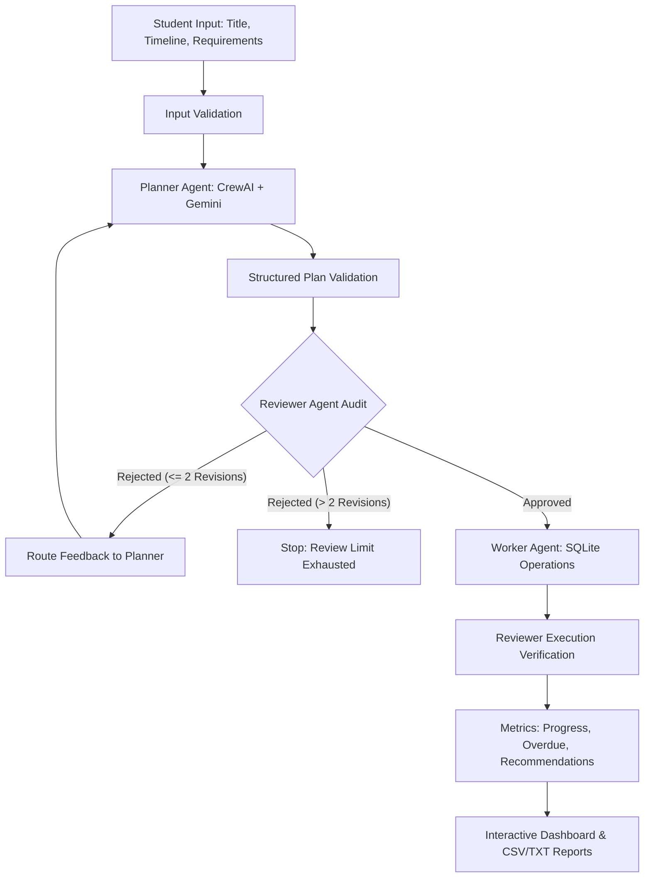

# 🎓 Final-Year Project Tracker Agent

An AI-powered multi-agent system built with **Python**, **CrewAI**, **Google Gemini API**, **Streamlit**, and **SQLite** designed to help college and university students plan, organize, track, and manage their final-year capstone engineering projects.

---

## 🌟 Key Features

- **Exactly Three AI Agents:**
  1. 📋 **Planner Agent:** Analyzes project requirements, abstract, timeline, and syllabus documents to produce a structured JSON breakdown into milestones and tasks with priorities, suggested deadlines, and dependencies.
  2. ⚙️ **Worker Agent:** Executes approved plans, updates task statuses in SQLite, calculates progress percentage, detects overdue deadlines, recommends next actions, and exports CSV/TXT reports.
  3. 🔍 **Reviewer Agent:** Quality assurance auditor that validates dates against project bounds, catches circular dependencies, verifies calculation integrity against SQLite records, and routes targeted correction feedback.
- **Bounded Self-Correction Loop:** Enforces a maximum of **2 revision attempts** per planning cycle. If a proposed plan fails validation, targeted feedback is routed back to the Planner for correction.
- **Human-in-the-Loop & Interactive Plan Approval:** Students can choose between 1-Click Autonomous execution or interactive Human-in-the-Loop mode (`Plan & Review First`) to review Reviewer Agent feedback, edit tasks directly in an interactive table, and approve before saving to SQLite.
- **Manual Offline Tracking & Resilience:** Allows students to manually track tasks, update statuses, calculate progress, and export reports even if the Gemini API is offline or unconfigured.
- **Zero Hallucination Mathematics:** Numerical calculations (progress %, days overdue, dependency satisfaction) are executed deterministically in pure Python as the absolute source of truth.
- **SQLite Persistence:** All projects, milestones, tasks, dependencies, review logs, and execution logs persist in SQLite with foreign keys and cascade deletions.
- **Downloadable Reports:** Instant generation of executive project summaries in CSV and TXT formats.

---

## 🏗️ Multi-Agent Architecture



---

## 📁 Project Structure

```
final_year_project_tracker/
├── app.py                     # Streamlit interactive web application
├── requirements.txt           # Dependencies specification
├── README.md                  # Comprehensive documentation and run guide
├── .env                       # Environment configuration (ignored by git)
├── .env.example               # Template environment configuration
├── .gitignore                 # Git ignore file
├── agents/
│   ├── __init__.py
│   ├── planner.py             # Planner Agent (Project Planning Specialist)
│   ├── worker.py              # Worker Agent (Execution & Tracking Specialist)
│   └── reviewer.py            # Reviewer Agent (QA & Validation Specialist)
├── crew/
│   ├── __init__.py
│   └── orchestrator.py        # Multi-agent workflow orchestrator & self-correction loop
├── tools/
│   ├── __init__.py
│   └── project_tools.py       # Deterministic Python tools for SQLite CRUD, progress, overdue, reports
├── database/
│   ├── __init__.py
│   ├── db.py                  # SQLite database access layer & transactions
│   └── schema.sql             # Relational schema (projects, milestones, tasks, logs)
├── services/
│   ├── __init__.py
│   ├── gemini_service.py      # Google Gemini client (google-genai & CrewAI LLM)
│   └── report_service.py      # CSV and TXT export services
└── tests/
    ├── test_database.py       # SQLite CRUD, schema, and cascades
    ├── test_progress.py       # Progress calculation & 0-task safety
    ├── test_overdue.py        # Overdue detection & next-task recommendation
    ├── test_reviewer.py       # QA review, date bounds, circular dependencies
    ├── test_workflow.py       # End-to-end multi-agent orchestration & revision limit
    ├── test_api_fallback.py   # HTTP 429/503 recovery and offline manual mode
    └── test_live_api.py       # Optional live Gemini API smoke test
```

---

## 🗄️ Database Schema

The SQLite schema consists of 6 tables with foreign-key integrity enabled:
- `projects`: id, title, description, start_date, deadline, created_at, updated_at
- `milestones`: id, project_id, title, description, due_date, status
- `tasks`: id, project_id, milestone_id, title, description, priority, due_date, status, created_at, updated_at
- `task_dependencies`: task_id, depends_on_task_id (Composite PK)
- `review_logs`: id, project_id, attempt, decision, feedback, created_at
- `execution_logs`: id, agent_role, action, status, message, created_at

---

## 🧮 Progress & Deadline Rules

1. **Equal-Weight Progress Calculation:**
   $$\text{Progress \%} = \frac{\text{Completed Tasks}}{\text{Total Tasks}} \times 100$$
   - A project with zero tasks returns **0.0%** safely.
   - Only tasks with `status == 'Completed'` are counted in the numerator.
2. **Overdue Task Detection:**
   - A task is flagged as overdue when its `due_date < current_date` and `status != 'Completed'`.
   - `days_overdue` is computed using Python's `datetime.date`.
3. **Dependency-Aware Next-Task Recommendation:**
   - Tasks with incomplete pre-requisites (`depends_on_task_id` not Completed) are filtered out.
   - Tasks are prioritized:
     1. Status `In Progress` first (finish active work)
     2. Priority: `Critical` (4) > `High` (3) > `Medium` (2) > `Low` (1)
     3. Earliest deadline
     4. Lowest Task ID (tie-breaker)

---

## 💻 Windows & VS Code Setup Instructions

Follow these exact PowerShell commands in Windows:

### 1. Open Project Folder in PowerShell
```powershell
cd C:\Users\nprhp\.gemini\antigravity\scratch\final_year_project_tracker
```

### 2. Create Virtual Environment
```powershell
python -m venv .venv
```

### 3. Activate Virtual Environment
```powershell
.\.venv\Scripts\Activate.ps1
```
*(If PowerShell restricts script execution, run: `Set-ExecutionPolicy -Scope Process -ExecutionPolicy Bypass`)*

### 4. Install Dependencies
```powershell
pip install -r requirements.txt
```

### 5. Configure `.env`
Copy `.env.example` to `.env` and set your Google Gemini API key:
```powershell
Copy-Item .env.example .env
```
Edit `.env`:
```ini
GEMINI_API_KEY=AIzaSy...your_real_gemini_api_key_here...
GEMINI_MODEL=gemini-3.8-flash
DATABASE_PATH=project_tracker.db
```

### 6. Initialize Database
The SQLite database initializes automatically on first run, or you can verify via python:
```powershell
python -c "from database.db import init_db; init_db(); print('Database schema initialized!')"
```

### 7. Run Automated Pytest Suite
```powershell
pytest -v
```

### 8. Start Streamlit Application
```powershell
streamlit run app.py
```
The application will open in your default browser at `http://localhost:8501`.

---

## 🧪 Demonstration Scenarios

### Scenario 1: Successful Normal Workflow
1. Open the **Run Multi-Agent Workflow** tab in Streamlit.
2. Enter:
   - **Title:** Autonomous Quadcopter Navigation System
   - **Start Date:** Today
   - **Deadline:** 90 days from today
   - **Description:** ROS2, Gazebo simulation, computer vision with OpenCV, and PID altitude control.
3. Click **Run Multi-Agent Workflow**.
4. **Planner Agent** generates milestones and tasks in structured JSON.
5. **Reviewer Agent** audits date bounds and dependencies (Attempt 1: Approved).
6. **Worker Agent** persists data to SQLite and calculates progress.
7. Results, next task recommendation, and CSV/TXT reports are generated and displayed immediately.

### Scenario 2: Overdue-Task Detection
1. Select the project in the dashboard.
2. In the **Update Task Status** tab, observe tasks whose due date has passed.
3. Notice the prominent **Overdue Alert Banner** highlighting overdue tasks with exact days overdue.
4. Mark the task as `Completed` in the status selector.
5. The overdue banner updates dynamically, removing the completed task.

### Scenario 3: Reviewer Rejection & Bounded Correction Handling
1. If the Planner proposes a task with a due date past the final deadline or a circular dependency:
2. **Reviewer Agent** rejects the plan on Attempt 1 (`decision: Rejected`).
3. Feedback is routed back to the Planner Agent.
4. Planner incorporates feedback and regenerates the corrected plan (Attempt 2).
5. Reviewer validates and approves the corrected plan.
6. If 2 revisions are exhausted without resolution, the workflow halts safely and reports `Review Limit Exhausted`.
*(Verified in automated test `test_workflow_self_correction_bounded_revision`)*.

### Scenario 4: Gemini API Failure & Manual Offline Fallback
1. If `GEMINI_API_KEY` is missing or when checked, returns HTTP 429 / 503:
2. The system logs a warning and automatically activates **Manual / Offline Mode**.
3. A standardized curriculum template is persisted into SQLite.
4. All SQLite CRUD operations, Python calculations, and CSV/TXT report downloads function without error.
*(Verified in automated test `test_api_fallback.py`)*.

---

## 🛠️ Troubleshooting

- **ModuleNotFoundError:** Ensure your virtual environment is active: `.\.venv\Scripts\Activate.ps1`.
- **Gemini HTTP 429 Quota Exceeded:** The application will seamlessly fallback to manual offline mode so student work is never interrupted. Wait a few moments for quota refresh or use offline mode.
- **Model Not Found (404):** Make sure `GEMINI_MODEL=gemini-3.8-flash` is set in `.env`.
- **Database Lock:** SQLite handles multiple connections with WAL and transactions. If locked, ensure no open SQLite viewers are running exclusive transactions.
